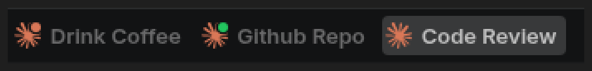

# vscode-claude-code-tab-patch

Two quality-of-life patches for the [Claude Code](https://claude.com/claude-code) VS Code
extension:

- **Rename tabs.** Give each Claude Code tab your own name, so five parallel sessions
  stop looking identical. The name sticks — normal tab updates don't clobber it, and it
  survives a window reload.
- **Busy indicator.** The tab icon grows a green badge while Claude is actively working,
  so you can tell at a glance which session is still thinking.



| Tab icon | Meaning |
| --- | --- |
| `claude-logo.svg` | idle |
| `claude-logo-busy.svg` (green badge) | Claude is working — **added by this patch** |
| `claude-logo-done.svg` | finished, output unseen |
| `claude-logo-pending.svg` | waiting on a permission prompt |

> **Scope:** this patches the Claude Code extension, so it applies to **Claude Code tabs
> only**. It does not rename ordinary file/editor tabs. For those, VS Code has a built-in:
> `workbench.editor.customLabels.patterns`.

## How it works

The extension ships minified, so there is nothing to configure — the patch edits the
bundle in place. It threads an `isBusy` flag from the webview's reactive
`session.busy.value` through `renameTab()` into the extension's tab-icon selector, and
registers a new `claude-vscode.renameTab` command whose custom title is stored in
`globalState` and re-applied on panel restore.

Every step matches on **dynamically detected** minified identifiers rather than
hardcoded ones, so a rename of `e` to `t` between releases doesn't break it. Ten
post-patch markers assert that each step actually landed — a half-applied patch fails
loudly instead of silently dropping a feature.

## Requirements

`bash`, `perl`, `python3`, `grep -P` (GNU grep). Linux/macOS. `notify-send` optional.
`node` optional — without it the icon-precedence behaviour test is skipped (and says so).

## Install

```bash
git clone https://github.com/mrmseals-tech/vscode-claude-code-tab-patch.git
cd vscode-claude-code-tab-patch
./patch-claude-busy-indicator.sh
```

Then reload VS Code: <kbd>Ctrl+Shift+P</kbd> → **Developer: Reload Window**.

To rename a tab: <kbd>Ctrl+Shift+P</kbd> → **Claude Code: Rename Tab**, or right-click the
tab. An empty name resets it.

> **If your extension is already patched** and you have no backup, the script refuses to
> run rather than record already-patched files as the "original" — that would silently
> destroy your ability to roll back. Reinstall the extension in VS Code to get vanilla
> files, or point `CLAUDE_PATCH_BACKUP_DIR` at the backups you already have.

## Re-applying after extension updates

Every Claude Code update overwrites the bundle and reverts the patch. The systemd user
units re-apply it automatically:

```bash
mkdir -p ~/.config/systemd/user
cp systemd/claude-auto-patch.{path,service} ~/.config/systemd/user/
# point the unit at THIS checkout (systemd needs an absolute or %h path):
sed -i "s|%h/CHANGEME/vscode-claude-code-tab-patch|$PWD|" ~/.config/systemd/user/claude-auto-patch.service
systemctl --user daemon-reload
systemctl --user enable --now claude-auto-patch.path
```

The path unit watches the extensions directory; on any change the service re-runs the
patch if — and only if — a marker is missing. Logs: `journalctl --user -u claude-auto-patch`.

Or just re-run `./patch-claude-busy-indicator.sh` by hand. It is idempotent.

## Verify and roll back

```bash
./verify-claude-patch.sh   # asserts all 16 markers; exit 0 = healthy
./claude-rollback.sh       # restore vanilla files, then reload VS Code
```

The self-test runs two independent checks, because they answer different questions:

1. **markers** — are our edits present? (greps, via `claude-patch-markers.sh`)
2. **behaviour** — do they do the right thing? (`test-icon-precedence.js`)

The second exists because the first cannot see ordering. The busy arm once sat below
upstream's `done` arm, so a tab stayed orange for the entire turn while all 16 markers
reported green. The behaviour test pulls the real classifier out of the built
`extension.js`, evaluates it, and asserts which icon each flag combination resolves to —
including the exact case that regressed. It covers both upstream dialects (the 2.1.261+
keyed classifier and the older inline `if/else` chain). Run it directly against any build:

```bash
node test-icon-precedence.js ~/.vscode/extensions/anthropic.claude-code-*/extension.js
# exit 0 = correct, 1 = present but wrong precedence, 2 = our arm is not there
```

On failure either check writes a `claude-patch-BROKEN.flag` into the state directory and
raises a persistent desktop notification, so a partial or misbehaving patch can't go
unnoticed.

## Configuration

All paths are environment-overridable; nothing assumes a checkout location.

| Variable | Default |
| --- | --- |
| `CLAUDE_PATCH_STATE_DIR` | `${XDG_STATE_HOME:-~/.local/state}/claude-code-tab-patch` |
| `CLAUDE_PATCH_BACKUP_DIR` | `$CLAUDE_PATCH_STATE_DIR/backup` |
| `CLAUDE_PATCH_FLAG` | `$CLAUDE_PATCH_STATE_DIR/claude-patch-BROKEN.flag` |
| `CLAUDE_PATCH_EXT_DIR` | `~/.vscode/extensions` |
| `CLAUDE_PATCH_EXT_PATTERN` | `anthropic.claude-code-*` |
| `CLAUDE_PATCH_NO_NOTIFY` | unset — set to `1` to suppress desktop notifications |

Set `CLAUDE_PATCH_EXT_DIR` for non-stock builds: `~/.vscode-insiders/extensions`,
`~/.vscode-oss/extensions`, `~/.vscode-server/extensions`, `~/.cursor/extensions`.

Set `CLAUDE_PATCH_NO_NOTIFY=1` when testing the failure path. `notify-send` talks to
the session D-Bus, which overriding `$HOME` or the state dir does **not** sandbox, so a
sandboxed failing run otherwise raises a persistent critical "BROKEN" popup about an
extension that is perfectly healthy. It suppresses only the popup: exit status, the
BROKEN flag and all output are unchanged.

## Files

| File | Role |
| --- | --- |
| `patch-claude-busy-indicator.sh` | The patcher — 9 steps plus verification |
| `claude-patch-markers.sh` | Single source of truth for the 16 verification markers |
| `claude-patch-paths.sh` | Single source of truth for every path used |
| `verify-claude-patch.sh` | Standalone self-test with visible escalation |
| `test-icon-precedence.js` | Behaviour test: evaluates the real classifier and checks icon precedence |
| `auto-patch-claude.sh` | Re-apply wrapper for the systemd units |
| `claude-rollback.sh` | Break-glass restore from backup |

## Compatibility

Developed against **`anthropic.claude-code-2.1.239`** on Linux. Because it rewrites a
minified bundle, an upstream refactor can still move a pattern out from under a step.
When that happens the run fails loudly, naming the step — the fix is usually a one-line
regex update, and the comments in `patch-claude-busy-indicator.sh` record which upstream
changes broke which anchors before (2.1.167, 2.1.226, 2.1.229) and how each was re-anchored.

## Disclaimer

Unofficial and unaffiliated with Anthropic. It modifies installed extension files, which
is unsupported and may break at any release. Backups are taken before the first patch and
`claude-rollback.sh` restores them. Use at your own risk.

No Anthropic code is redistributed here — these scripts only transform what is already
installed on your machine.

## License

MIT — see [LICENSE](LICENSE).
